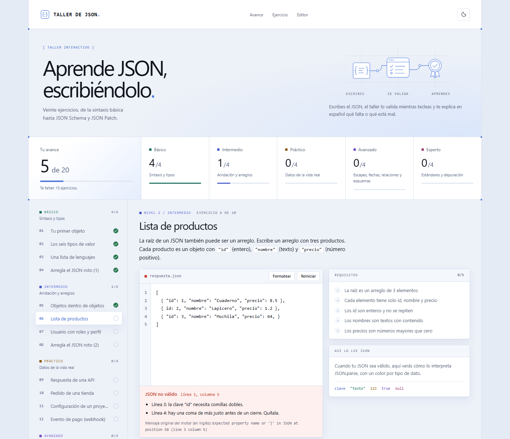
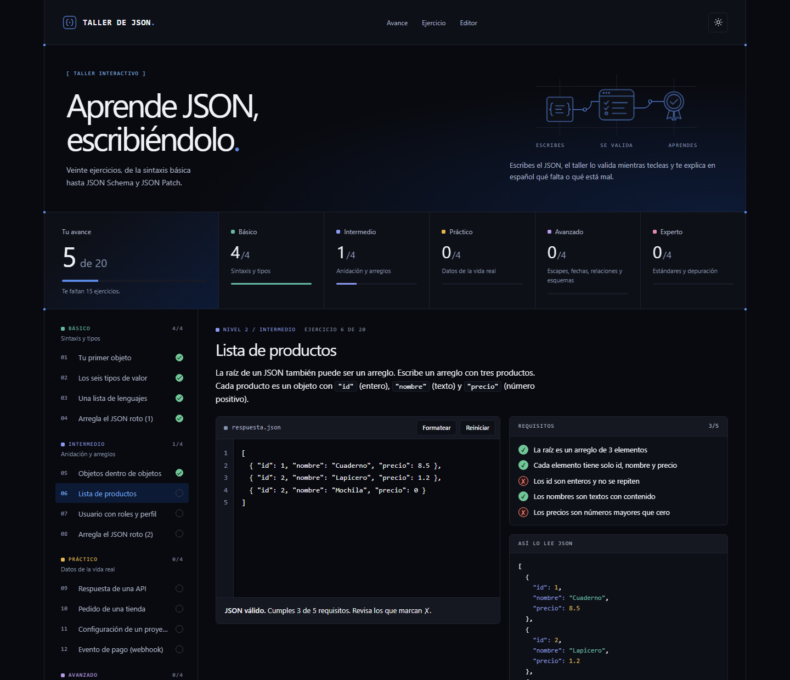

# Taller de JSON

Taller interactivo para aprender JSON escribiéndolo. Son 20 ejercicios que van de la sintaxis básica hasta JSON Schema y JSON Patch. Escribes en un editor, la página valida tu JSON mientras tecleas y te explica **en español** qué falta o qué está mal.

**Pruébalo en línea:** [alex-varillas.github.io/taller-json](https://alex-varillas.github.io/taller-json/)

No necesita instalación ni cuenta. Es una página estática sin dependencias, así que también funciona descargada y sin conexión.



## Contenido

- [Qué ofrece](#qué-ofrece)
- [Empezar](#empezar)
- [Cómo se usa](#cómo-se-usa)
- [Los 20 ejercicios](#los-20-ejercicios)
- [Errores que sabe explicar](#errores-que-sabe-explicar)
- [Tu progreso](#tu-progreso)
- [Estructura del proyecto](#estructura-del-proyecto)
- [Añadir o cambiar ejercicios](#añadir-o-cambiar-ejercicios)
- [Diseño y accesibilidad](#diseño-y-accesibilidad)
- [Ideas pendientes](#ideas-pendientes)
- [Licencia](#licencia)

## Qué ofrece

- **Validación en vivo.** Cada vez que escribes, el taller intenta leer tu JSON y te dice si es válido.
- **Errores explicados en español.** En lugar de solo mostrar el mensaje del navegador (en inglés), señala la línea y la causa: una clave sin comillas, una coma de más, una llave sin cerrar…
- **Requisitos con ✓ y ✗.** Cada ejercicio tiene una lista de requisitos. Ves cuáles cumples y cuáles faltan.
- **Cualquier respuesta correcta vale.** Los requisitos comprueban la estructura y el sentido de los datos (por ejemplo, que un total sea la suma real de las líneas), no que escribas exactamente la misma solución.
- **Vista "Así lo lee JSON".** Muestra cómo interpreta tu texto `JSON.parse`, con un color por tipo de dato.
- **Pista y solución.** La pista ayuda sin resolver. La solución de referencia pide confirmación antes de mostrarse, para que no la veas sin querer.
- **Progreso guardado.** Tus avances y borradores se guardan en el navegador. Puedes cerrar la página y seguir después.
- **Tema claro y oscuro.** El claro es el predeterminado; el botón de la cabecera cambia al oscuro y recuerda tu elección.



## Empezar

### Opción 1: usarlo en línea

Abre [alex-varillas.github.io/taller-json](https://alex-varillas.github.io/taller-json/). Está publicado con GitHub Pages y se actualiza solo con cada cambio en la rama `main`.

### Opción 2: abrir el archivo

Descarga el repositorio y abre `index.html` con doble clic. No hace falta nada más.

```bash
git clone https://github.com/alex-varillas/taller-json.git
```

### Opción 3: servirlo en local

Si tienes [Node.js](https://nodejs.org/) 18 o superior, puedes servir la carpeta con un servidor local:

```bash
npm start
```

La primera vez, `npx` descarga el paquete [`serve`](https://www.npmjs.com/package/serve). La consola te dirá en qué dirección abrir la página (normalmente `http://localhost:3000`).

### Comprobar los ejercicios

```bash
npm test
```

Verifica que la solución de cada ejercicio cumple todos sus requisitos y que el punto de partida no los cumple por sí solo.

## Cómo se usa

1. Elige un ejercicio en la lista de la izquierda (en el móvil, con el botón **Ver ejercicios**).
2. Lee el enunciado y escribe tu JSON en el editor.
3. Mira el recuadro bajo el editor y la lista de **Requisitos**: te dicen qué corregir.
4. Si te atascas, pulsa **Ver pista**. Si quieres comparar, **Ver solución** (hay que pulsarlo dos veces).
5. Cuando cumples todos los requisitos, aparece lo que practicaste y el botón para seguir.

Atajos del editor:

| Tecla o botón | Qué hace |
| --- | --- |
| `Tab` | Inserta dos espacios. |
| `Enter` | Mantiene la sangría de la línea. Entre `{}` o `[]`, abre una línea nueva sangrada. |
| **Formatear** | Reordena la sangría de tu JSON (solo si ya es válido). |
| **Reiniciar** | Vuelve al texto inicial del ejercicio. |

## Los 20 ejercicios

| Nivel | Qué practicas | Ejercicios |
| --- | --- | --- |
| **1. Básico** | Sintaxis y tipos | Tu primer objeto · Los seis tipos de valor · Una lista de lenguajes · Arregla el JSON roto (1) |
| **2. Intermedio** | Anidación y arreglos | Objetos dentro de objetos · Lista de productos · Usuario con roles y perfil · Arregla el JSON roto (2) |
| **3. Práctico** | Datos de la vida real | Respuesta de una API · Pedido de una tienda (con total coherente) · Configuración de un proyecto (`package.json`) · Evento de pago (webhook) |
| **4. Avanzado** | Escapes, fechas, relaciones y esquemas | Escapes y Unicode · Línea de tiempo ordenada (fechas ISO 8601) · Relaciones por id · Tu primer esquema JSON |
| **5. Experto** | Estándares y depuración | Error estándar de API (RFC 9457) · Esquema con `$ref` y `enum` · Parche JSON (RFC 6902) · Depuración final |

## Errores que sabe explicar

Cuando el JSON no es válido, el taller revisa tu texto y te dice en qué línea está cada problema:

- Claves sin comillas dobles (`{ nombre: "Ana" }`).
- Comillas simples en lugar de dobles.
- Comas de más antes de `}` o `]`, y comas que faltan entre elementos.
- Llaves, corchetes o comillas que se abren y no se cierran, o que no corresponden.
- Comentarios (`//` o `/* */`), que JSON no permite.
- Valores de otros lenguajes: `True`, `False`, `None`, `undefined`, `NaN` o `Infinity`.
- Números que empiezan con cero, como `007`.
- Palabras que quedaron fuera de las comillas.

Debajo aparece también el mensaje original del navegador, por si quieres compararlo.

## Tu progreso

El progreso se guarda solo en tu navegador, con `localStorage`. No se envía a ningún sitio.

| Clave | Qué guarda |
| --- | --- |
| `taller-json-v1` | Ejercicios resueltos, borradores y el ejercicio en el que estabas. |
| `taller-json-tema-v2` | El tema elegido, si cambiaste al oscuro. |

**¿Cuánto dura?** No caduca. El taller no borra nada por tiempo, y `localStorage` no es la caché del navegador: tus ejercicios resueltos siguen ahí aunque cierres la página o reinicies el equipo. Solo se pierden en estos casos:

- Si borras los datos de navegación marcando **cookies y datos de sitios**. Borrar solo la caché (imágenes y archivos) no los toca.
- Si usas una ventana privada o de incógnito: se borran al cerrarla.
- En Safari (iPhone, iPad y Mac): si pasas 7 días usando Safari sin entrar al taller, Safari borra lo que la página guardó.
- Si el dispositivo se queda sin espacio, el navegador puede liberar los datos de sitios poco usados.

Además, el progreso es de cada navegador y cada dispositivo. Si abres el taller en el móvil, empiezas de cero allí. La versión en línea y el archivo descargado también llevan progresos separados.

Para empezar de cero a propósito, borra los datos del sitio desde la configuración de tu navegador.

## Estructura del proyecto

```
taller-json/
├── index.html                     Estructura de la página
├── style.css                      Estilos y paleta de colores (tema claro y oscuro)
├── app.js                         Interfaz: editor, validación, diagnóstico, progreso, pistas
├── ejercicios.js                  Los 20 ejercicios, los 5 niveles y las ayudas de los validadores
├── test/
│   └── verificar-soluciones.js    Prueba que cada ejercicio está bien construido
├── docs/                          Capturas de este README
├── CLAUDE.md                      Guía del proyecto para Claude Code
└── package.json                   Scripts npm start y npm test
```

No hay paso de compilación: lo que ves en estos archivos es lo que carga el navegador.

## Añadir o cambiar ejercicios

Los ejercicios están en `ejercicios.js`, dentro de la lista `EX`. Cada uno es un objeto así:

```js
EX.push({
  nivel: 1,
  titulo: `Tu primer objeto`,
  enunciado: `Escribe un objeto con §"nombre"§ (texto) y §"edad"§ (número).`,
  starter: R`{

}`,
  pista: `Las claves y los textos llevan comillas dobles. Los números van sin comillas.`,
  solucion: R`{
  "nombre": "Lucía",
  "edad": 28
}`,
  aprendiste: `Las claves siempre van entre comillas dobles.`,
  checks: [
    [`La raíz es un objeto`, v => isObj(v)],
    [`"nombre" es un texto con contenido`, v => isObj(v) && isStr(v.nombre)],
    [`"edad" es un número`, v => isObj(v) && typeof v.edad === 'number'],
  ],
});
```

| Campo | Para qué sirve |
| --- | --- |
| `nivel` | Del 1 al 5. Coincide con la lista `LEVELS`. |
| `titulo`, `enunciado` | Lo que ve la persona al abrir el ejercicio. |
| `starter` | El texto con el que empieza el editor. |
| `pista`, `aprendiste` | La pista y el resumen que aparece al resolverlo. |
| `solucion` | Una solución de referencia, como texto. |
| `checks` | Pares `[descripción, función]`. La función recibe el JSON ya interpretado y devuelve `true` o `false`. |
| `refs` (opcional) | Bloques de código de apoyo que se muestran sobre el editor. |

Algunas reglas:

- En `enunciado`, `pista` y `aprendiste`, el texto entre `§` se muestra como código. Van siempre en pares.
- Los requisitos deben comprobar la estructura y el sentido de los datos, no comparar con una respuesta exacta.
- Hay funciones de ayuda al principio de `ejercicios.js`: `isObj`, `isStr`, `sameKeys`, `same`, `validDate`, `validDateTime` y otras.
- Después de cualquier cambio, ejecuta `npm test`.
- Si reordenas o quitas ejercicios, cambia la clave `taller-json-v1` en `app.js` (por ejemplo, a `taller-json-v2`). El progreso de todos empezará de cero una vez, pero no se mezclarán avances de ejercicios distintos.

## Diseño y accesibilidad

- Paleta basada en [navel-ai.com](https://navel-ai.com/), con el azul `#4A78DC` como acento. Todos los colores son variables CSS en `:root`, así que cambiar la paleta es editar un solo bloque.
- Los textos cumplen un contraste mínimo de 4,5:1 en ambos temas.
- Todo se puede usar con teclado, y hay un enlace para saltar directamente al ejercicio.
- Las animaciones se desactivan si el sistema pide reducir el movimiento.
- Se adapta a móvil, tablet y escritorio.

## Ideas pendientes

- Más ejercicios de JSON Schema (`oneOf`, `pattern`, `format`).
- Un modo "repaso" que mezcle ejercicios ya resueltos.
- Importar y exportar el progreso como archivo.

### Con Claude Code

El archivo `CLAUDE.md` explica la estructura y las reglas del proyecto a [Claude Code](https://claude.com/claude-code). Abre una terminal en la carpeta, ejecuta `claude` y pídele, por ejemplo:

- "Añade tres ejercicios de JSON Schema con `oneOf` y `pattern`."
- "Agrega un botón para exportar e importar mi progreso."
- "Crea un modo repaso que mezcle los ejercicios que ya resolví."

## Licencia

[MIT](LICENSE) © 2026 Alex Varillas. Puedes usar, copiar, modificar y distribuir el código, también con fines comerciales, siempre que conserves el aviso de copyright y el texto de la licencia.
